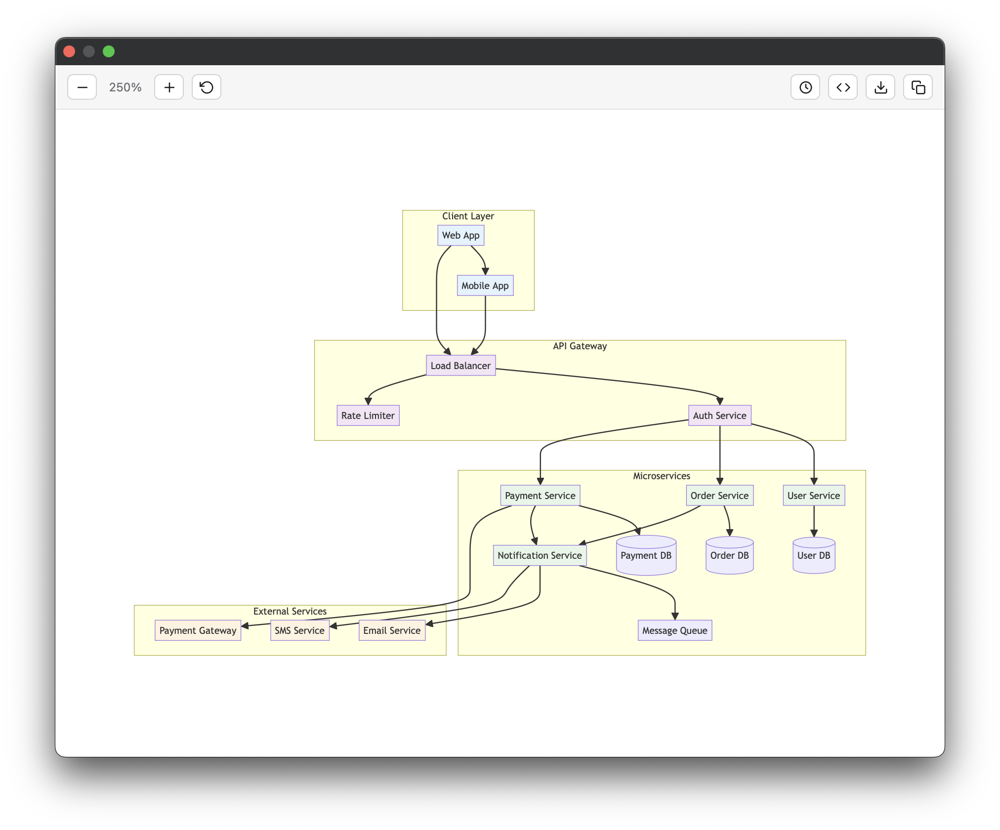

# QuickMermaid

> Instantly render selected Mermaid text into a diagram — from any app.

QuickMermaid is a lightweight macOS menu-bar app that turns Mermaid source text
into a rendered diagram in a floating quick-look panel. Select Mermaid text
anywhere, trigger it, and the diagram pops up — no editor, no context switch.

<p align="center">
  
</p>


## Why

When a tool (an LLM in your terminal, a code review, a doc) hands you Mermaid
*source*, you can't see the diagram without pasting it into an editor or a web
page. QuickMermaid renders it in place: select → shortcut (or right-click
Services, or pipe via CLI) → diagram. Think Quick Look, not Preview.app.

## Features

- **Render from anywhere** — system Services menu, a global keyboard shortcut, or the `qmmd` CLI.
- **Source priority** — uses the current selection; falls back to the clipboard; shows nothing if there is no renderable text.
- **Zoom, pan & fit** — buttons, `⌘+ / ⌘− / ⌘0`, `⌘`+scroll, trackpad pinch; drag to pan; **fit-to-window** button or `Space` re-fits the diagram after you resize the window.
- **Themes & background** — pick a Mermaid theme and a canvas background color.
- **Source view** — toggle the original source text with syntax highlighting; copy the **code** from here.
- **PNG export** — copy (`⌘C`) or save (`⌘S`) the **diagram only** (no toolbar, full size even off-screen).
- **Recent history** — recently rendered diagrams are kept with thumbnails; reopen one, **copy its image**, or delete it from the list.
- **Shareable links** — copy a diagram as a `quickmermaid://` link (toolbar button or `qmmd --link`); clicking that link in any app renders the diagram.
- **PlantUML too** — source that starts with `@startuml…@enduml` (and other `@start…` diagrams) is auto-detected and rendered by a vendored offline PlantUML engine. Mermaid stays the primary focus.
- **Offline** — Mermaid and the PlantUML engine are vendored; no network required.

## Install

Download the latest `QuickMermaid-x.y.z.dmg` from
[Releases](https://github.com/wicksome/quick-mermaid/releases), open it, and drag
**QuickMermaid.app** to `/Applications`.

The app is unsigned (ad-hoc), so on first launch Gatekeeper will warn you. Either:

- Right-click the app → **Open** → **Open**, or
- `xattr -dr com.apple.quarantine /Applications/QuickMermaid.app`

Prefer to build it yourself? `./build.sh --install` (see [AGENTS.md](AGENTS.md)).

## Usage

QuickMermaid runs in the menu bar. There are three ways to render — the CLI is
the most reliable for terminal workflows.

### A) CLI — `qmmd`

```bash
pbpaste | qmmd      # render the clipboard
qmmd flow.mmd       # render a file
qmmd                # no input → open Settings
```

### B) Services (right-click)

Select Mermaid text in any app that exposes selections to macOS Services
(Safari, TextEdit, Terminal, iTerm2, …) → **right-click → Services → Render Mermaid**.

> Apps cache the Services menu at launch. If the item doesn't appear, fully quit
> and relaunch that app, or run `/System/Library/CoreServices/pbs -update`.
> Note: Chrome doesn't show the Services submenu in its context menu — use the
> global shortcut there.

### C) Global shortcut

Enable it in **Settings** (default `⌃⌘M`). With the shortcut on, press it to
render — QuickMermaid uses the current **selection** (it copies it for you), or
falls back to whatever is on the **clipboard** when nothing is selected. This
works everywhere, including Chrome.

> The shortcut grabs the selection by synthesizing `⌘C`, which requires
> **Accessibility** permission (macOS prompts you when you enable it).
>
> The app is unsigned, so **every update is a new binary and macOS drops the
> previous grant.** After updating, re-allow QuickMermaid under **System Settings
> → Privacy & Security → Accessibility** (toggle it off/on, or remove and re-add
> it). Until you do, the shortcut still renders the clipboard but can't grab
> selections.

### D) Clickable links — `quickmermaid://`

QuickMermaid registers a `quickmermaid://render?data=<base64url>` URL scheme, so a
diagram can travel as a clickable link. Click one in any app (notes, Slack, a
Markdown preview, the terminal) and the diagram renders — no need to copy the
source first.

Create a link from existing source:

```bash
pbpaste | qmmd --link     # print a quickmermaid:// link for the clipboard
qmmd --link flow.mmd      # …for a file
```

…or, while viewing a diagram, use the **Copy as link** toolbar button (the chain
icon) to put the link on your clipboard.

> The payload is just the diagram source, base64url-encoded in the URL — no
> network, nothing fetched. Very large diagrams make very long URLs; some apps
> truncate long links, so for big diagrams prefer the source directly.

### In the panel

- **Zoom**: `⌘+ / ⌘− / ⌘0`, `⌘`+scroll, pinch, or the toolbar buttons; drag to pan.
- **Fit to window** (toolbar button or `Space`): re-fit the diagram to the current window size — handy after enlarging the window.
- **`</> Source`** (toolbar button or `/`): toggle the original source text, syntax-highlighted (Mermaid or PlantUML); here Copy / `⌘C` copies the **code**. Press `/` again to return to the diagram. (Unavailable while History is open.)
- **Copy PNG / `⌘C`**, **Save PNG / `⌘S`**: export the diagram only.
- **Copy as link** (chain icon): copy a `quickmermaid://` link carrying the source — available in the diagram and source views.
- **History**: hover a recent-diagram row to **copy its image** or delete it; click it to reopen.
- **Esc** or click outside to close (configurable in Settings).

### Settings

Open via `qmmd` (no input) or the menu-bar icon → **Settings**. Configure the
default theme, default zoom, background color, the global shortcut, and whether
the panel closes when it loses focus. A live preview reflects your choices.

- **Font** — pick a diagram-text font (any installed system font), or "Default" to keep
  each engine's built-in font. Applies to both Mermaid and PlantUML. PlantUML coverage
  depends on the diagram type (`skinparam defaultFontName`); some non-UML types may ignore it.

## Limitations

- Unsigned / not notarized — intended for personal use; Gatekeeper warns on first launch.
- Very large diagrams: Mermaid limits are raised; beyond them the error view explains why. PNG export is capped at ~8192 px.

## Development

This project is developed primarily by AI. Architecture, build/verify steps,
conventions, and release process are in **[AGENTS.md](AGENTS.md)**.

## License

[MIT](LICENSE). Bundled third-party engines (Mermaid, PlantUML, Viz.js/Graphviz,
TeaVM, Expat) retain their own licenses — see
[THIRD-PARTY-LICENSES.md](THIRD-PARTY-LICENSES.md). PlantUML is multi-licensed and
used here under its MIT option.
